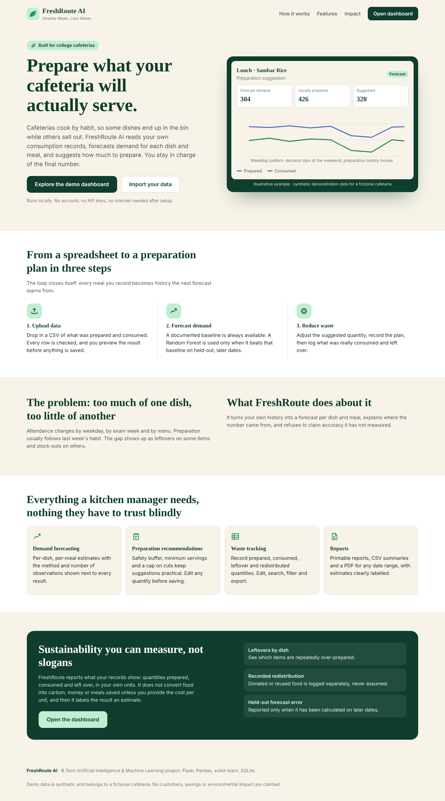
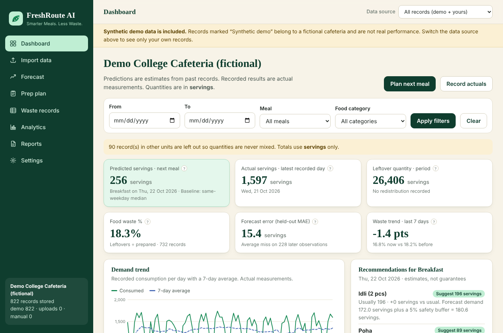
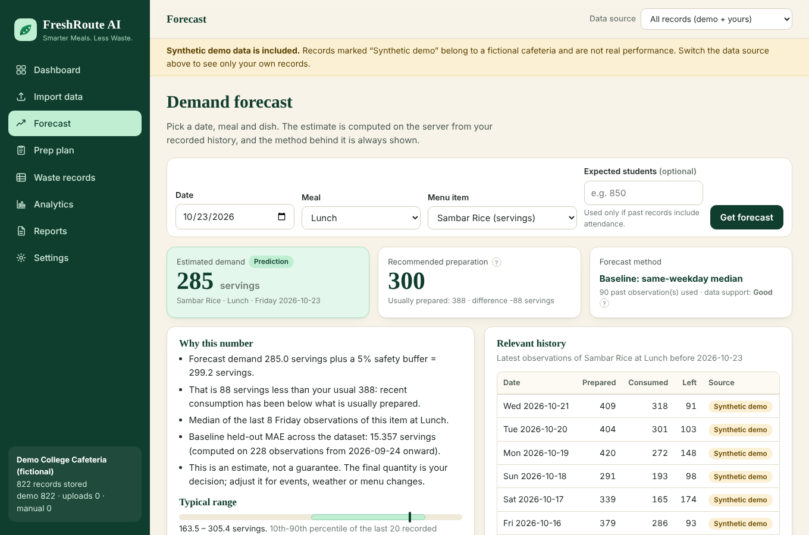
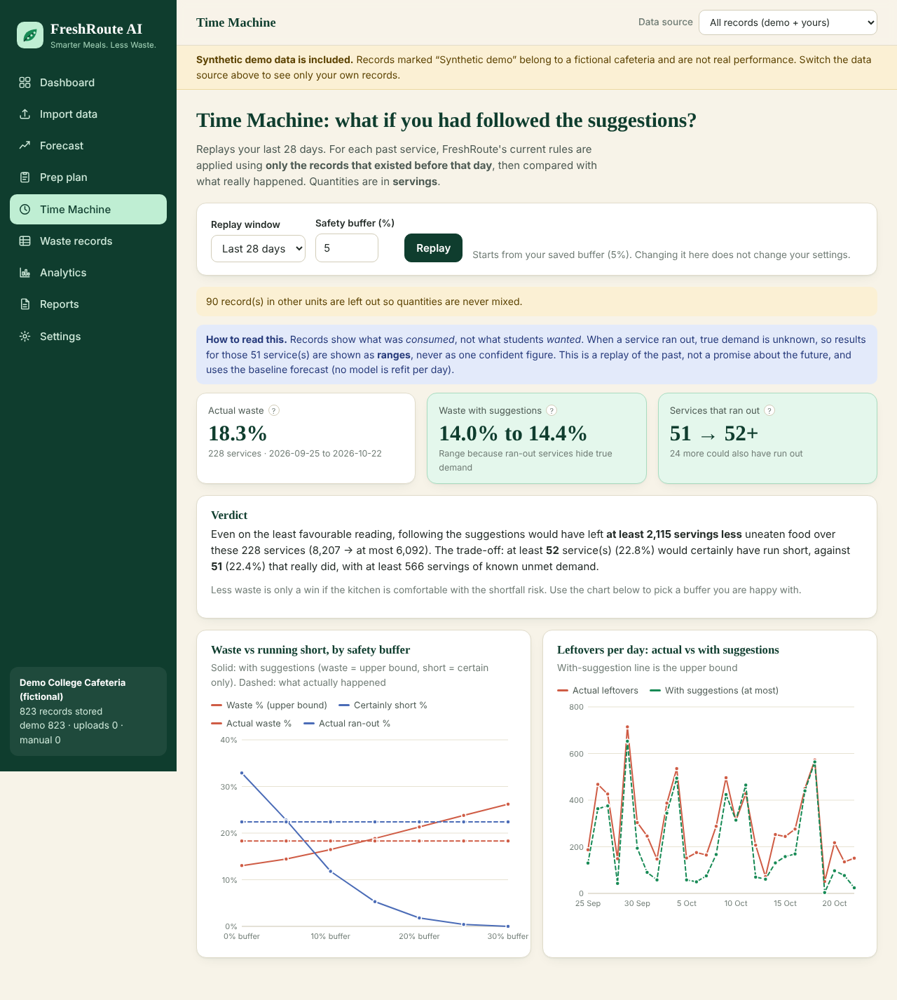
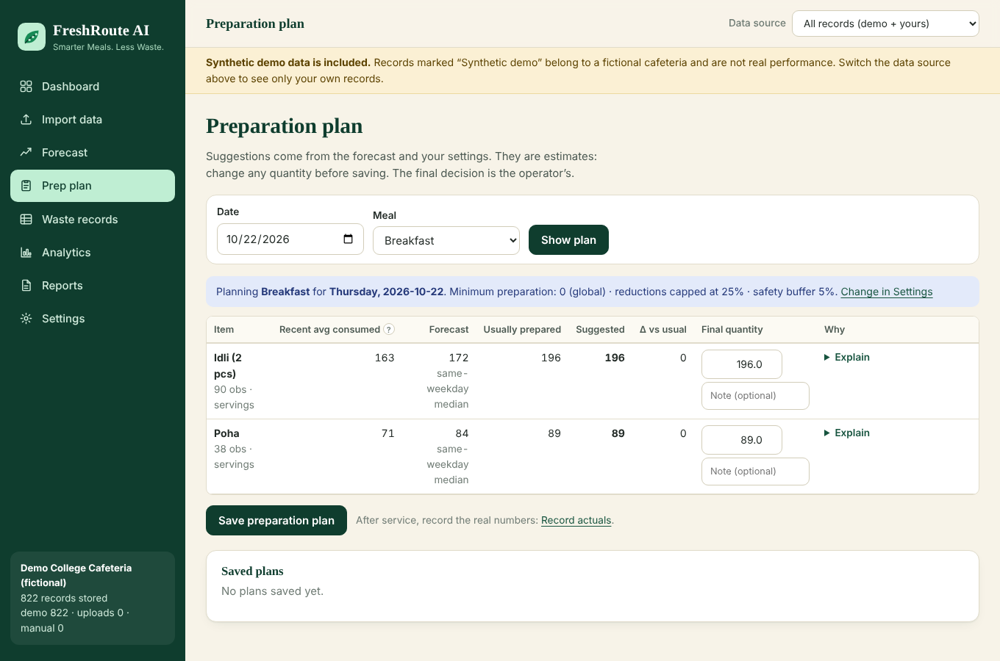
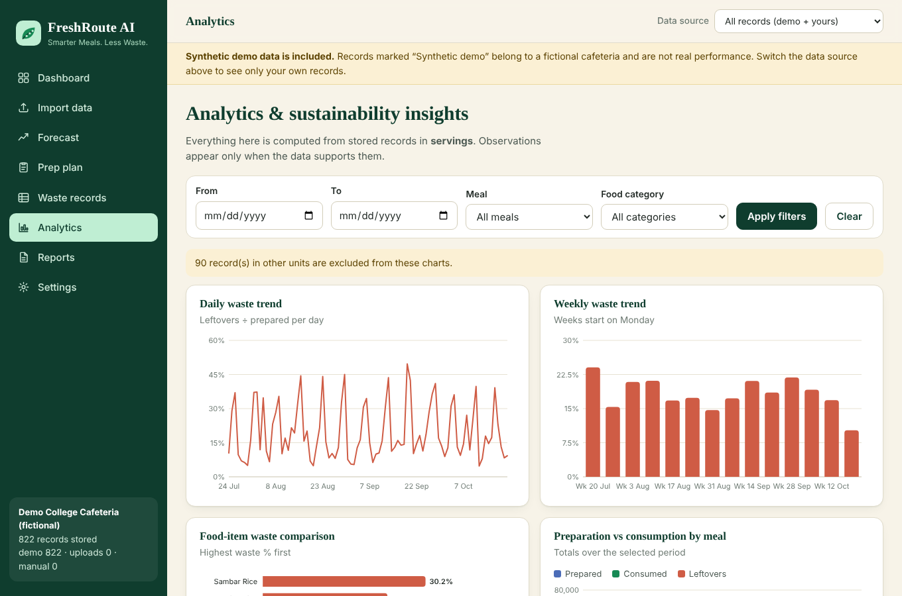
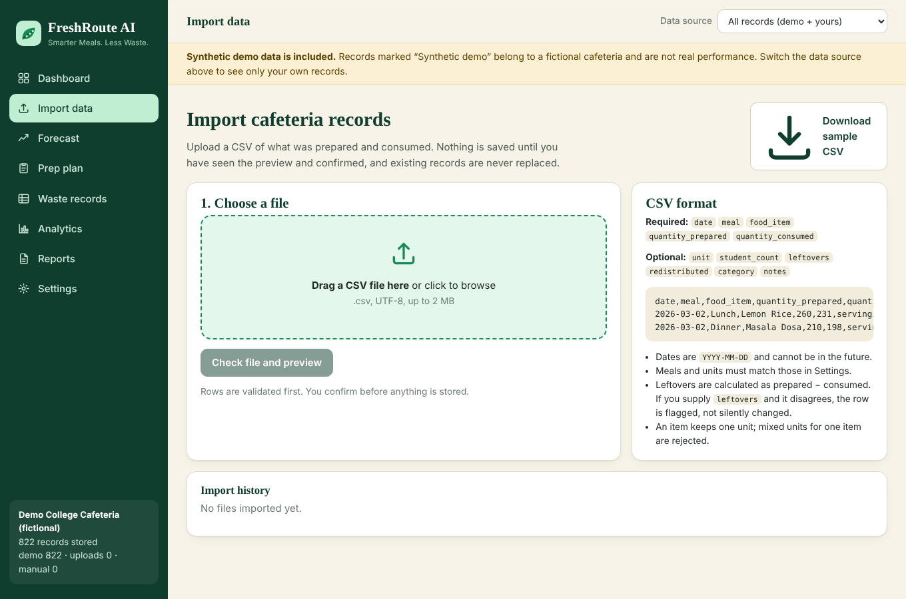
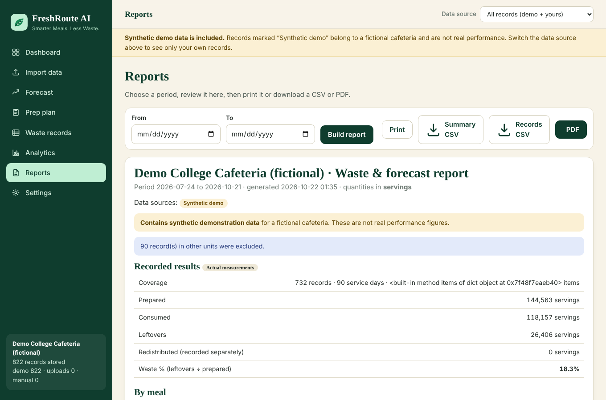
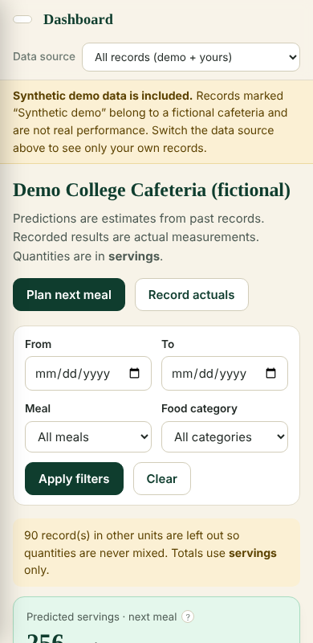
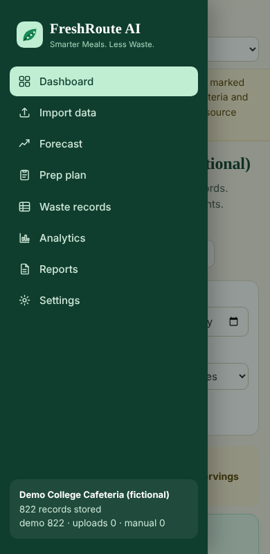

# FreshRoute AI

**Smarter Meals. Less Waste.**

FreshRoute AI is a local web application that helps college cafeterias forecast how much of each dish students will eat, suggest how much to prepare, and track the food that is left over. It was built as a B.Tech Artificial Intelligence & Machine Learning portfolio project.

> Everything runs on your own machine: Flask, SQLite, Pandas and scikit-learn. No paid APIs, no API keys, and no internet connection needed after the dependencies are installed.



## Contents

1. [Problem statement](#problem-statement)
2. [Features](#features)
3. [Screenshots](#screenshots)
4. [Technology stack](#technology-stack)
5. [Architecture](#architecture)
6. [Folder structure](#folder-structure)
7. [Installation on Windows 11](#installation-on-windows-11)
8. [Running the app and loading demo data](#running-the-app-and-loading-demo-data)
9. [CSV schema](#csv-schema)
10. [Forecasting methodology](#forecasting-methodology)
11. [Evaluation methodology](#evaluation-methodology)
12. [Waste formulas](#waste-formulas)
13. [Demo walkthrough](#demo-walkthrough-for-professors-and-recruiters)
14. [Testing](#testing)
15. [Limitations](#limitations)
16. [Security notes](#security-notes)
17. [Future enhancements](#future-enhancements)

## Problem statement

College cafeterias usually prepare food by habit. Attendance, menus, weekdays, exams and events all change demand, so some dishes are over-prepared (leftovers) while others sell out. Staff rarely have a quick way to turn their own consumption records into a data-driven preparation quantity.

FreshRoute AI closes that loop:

**Upload data → Validate and analyse → Forecast demand → Recommend preparation quantities → Track actual consumption and leftovers → Learn from historical results.**

It is useful even with a small dataset: when data is too thin for machine learning it falls back to a documented baseline and says so, instead of pretending a model is accurate.

## Features

| Area | What it does |
| --- | --- |
| **Landing page** | Public page with the problem, a three-step workflow, features, a sustainability section that makes no unsupported claims, and a call to action. |
| **Dashboard** | KPIs for the next meal's predicted servings, latest actual servings, leftover quantity, waste %, held-out forecast error and waste trend. Filters for date, meal and food category. Demand trend, predicted vs actual, waste by item, meal summary, recommendations, insights and recent activity. Honest empty states. |
| **Data import** | Drag-and-drop or file picker. Validates headers, dates, numbers and units; previews rows; shows valid/invalid/duplicate counts with plain-language reasons; never overwrites existing records; flags files that were already imported; sample CSV download. |
| **Forecasting** | Pick a date, meal and dish. Shows estimated demand, recommended preparation, method, number of observations, relevant history, an explanation and (only when supported) a typical range. |
| **Prep plan** | Per-item table with history, forecast, usual quantity, suggestion, difference and reasons. Edit the final quantity before saving; operational limits are configurable. |
| **Waste records** | Add, edit, delete, search, filter by date, meal, item and source; export filtered CSV. Redistribution is recorded separately and never assumed. |
| **Analytics** | Daily and weekly waste, item comparison, prepared vs consumed, waste by meal and weekday, predicted vs actual, evaluation metrics, rule-based insights with their evidence, and a labelled cost estimate when you supply costs. |
| **Time Machine** | Replays the last 14–90 days as if today's preparation rules had been followed, using only data that existed before each day, and compares waste and running-out with what really happened. Where a service ran out, true demand is unknown, so results are shown as ranges and shortfalls are counted only when certain. A buffer sweep shows the waste vs running-short trade-off. |
| **Reports** | Pick a period, review, print, download a summary CSV, a records CSV or a PDF. Estimates, sample data and actual results are labelled. |
| **Settings** | Cafeteria name, meals, units, safety buffer, minimum preparation, maximum reduction, waste thresholds, per-item costs, dataset deletion (typed confirmation) and demo reset. |
| **Demo mode** | A clearly labelled synthetic dataset for a fictional cafeteria (about 90 days, 12 dishes, 4 meals) is loaded on first run. Demo records are stored with their own source label and are never mixed with uploads without being identified. |

## Screenshots

| Dashboard | Forecast |
| --- | --- |
|  |  |

| Time Machine | |
| --- | --- |
|  | |

| Preparation plan | Analytics |
| --- | --- |
|  |  |

| Data import | Reports |
| --- | --- |
|  |  |

| Mobile dashboard | Mobile navigation |
| --- | --- |
|  |  |

The screenshots were captured from the running application with headless Chromium. All figures shown are synthetic demonstration data.

## Technology stack

* **Backend:** Python 3.10+, Flask
* **Data and ML:** Pandas, NumPy, scikit-learn (RandomForestRegressor), Joblib for model persistence
* **Storage:** SQLite with constraints and parameterised queries
* **Reports:** ReportLab (pure Python PDF)
* **Frontend:** HTML5, CSS3, vanilla JavaScript, Jinja templates and macros
* **Charts:** Chart.js when `freshroute/static/vendor/chart.umd.min.js` exists, otherwise a built-in accessible SVG renderer (same chart specs, so the app works offline either way)
* **Tests:** `unittest` (pytest compatible) plus optional Playwright browser checks

Tested with Python 3.13, Flask 3.1, pandas 3.0, NumPy 2.5, scikit-learn 1.9 and ReportLab 5.

## Architecture

```
Browser ── HTML pages (Jinja) + small JS ── Flask routes ──┐
                                                           ▼
                                  services.py  (filters, units, engine cache, next-meal logic)
                                  ┌─────────────┬───────────────┬─────────────────┐
                                  ▼             ▼               ▼                 ▼
                          forecasting.py  recommendations.py  analytics.py     reports.py
                                  │             │               │                 │
                                  └──────── repository.py (parameterised SQL) ────┘
                                                      │
                                                SQLite (instance/freshroute.sqlite3)
```

* `validation.py` is the single gatekeeper for data: CSV rows and manual entries go through the same `validate_record`.
* `forecasting.py` implements the baselines, the Random Forest, chronological evaluation and the fallback logic.
* `services.py` makes pages and the JSON API show identical numbers.
* Charts read JSON embedded in the page (`<script type="application/json">`); there are no inline scripts, so a strict Content-Security-Policy applies.

## Folder structure

```
freshroute-ai/
├── run.py                    start the app
├── requirements.txt
├── setup_windows.bat         one-time Windows setup
├── run_windows.bat           start the app on Windows
├── TODO.md                   build tracker
├── freshroute/
│   ├── __init__.py           app factory, security headers, error pages, CLI commands
│   ├── constants.py          schema columns, defaults, navigation
│   ├── db.py                 SQLite schema and connection helpers
│   ├── repository.py         all database queries
│   ├── validation.py         CSV and record validation
│   ├── waste.py              waste formulas and unit handling
│   ├── forecasting.py        baseline + Random Forest + evaluation
│   ├── recommendations.py    forecast → preparation suggestion (policy shared with Time Machine)
│   ├── backtest.py           Time Machine: honest what-if replay of the preparation policy
│   ├── analytics.py          KPIs, chart series, rule-based insights
│   ├── reports.py            report assembly, CSV and PDF export
│   ├── demo.py               synthetic demo dataset
│   ├── services.py           glue shared by pages and API
│   ├── routes/pages.py       HTML pages and form handlers
│   ├── routes/api.py         JSON endpoints
│   ├── templates/            Jinja templates and macros
│   └── static/               css, js (app.js, charts.js), img, vendor/
├── scripts/download_chartjs.py
├── tests/                    159 unit/integration tests + 2 optional browser scripts
└── docs/screenshots/
```

Created at runtime and ignored by Git: `instance/` (database, uploads, saved models, logs, secret key).

## Installation on Windows 11

You need Python 3.10 or newer from <https://www.python.org/downloads/> (tick **Add python.exe to PATH**) and, optionally, VS Code.

### Quick way

1. Open the project folder in File Explorer.
2. Double-click `setup_windows.bat` (creates `.venv`, installs dependencies, tries to fetch Chart.js).
3. Double-click `run_windows.bat`. Your browser opens at <http://127.0.0.1:5000>.

### Step by step (PowerShell in the project folder, or the VS Code terminal)

```powershell
# 1. Create and activate a virtual environment
py -3 -m venv .venv
.\.venv\Scripts\Activate.ps1
#   If activation is blocked:  Set-ExecutionPolicy -Scope Process -ExecutionPolicy Bypass

# 2. Install dependencies
python -m pip install --upgrade pip
python -m pip install -r requirements.txt

# 3. (Optional) download Chart.js so charts use it; the built-in SVG charts work without it
python scripts\download_chartjs.py

# 4. Initialise the database (this also happens automatically on first start)
python -m flask --app freshroute init-db

# 5. Start the app
python run.py
```

In VS Code, choose the `.venv` interpreter (**Ctrl+Shift+P → Python: Select Interpreter**). The included `.vscode/launch.json` has a **FreshRoute AI (Flask)** configuration and a **Run tests** configuration.

> The shipped commands were exercised on Linux. The code uses only cross-platform libraries and `pathlib`, but it has not been run on a Windows 11 machine. If something fails there, please check the log in `instance\logs\freshroute.log`.

## Running the app and loading demo data

```powershell
python run.py                 # http://127.0.0.1:5000
```

On the very first start, when the database is empty, the synthetic demo dataset is loaded automatically. You can also manage it explicitly:

```powershell
python -m flask --app freshroute seed-demo     # load demo data (never replaces existing records)
python -m flask --app freshroute reset-demo    # delete and recreate ONLY the demo records
```

The same actions are available in **Settings → Dataset management**. Environment variables: `PORT` (default 5000), `FRESHROUTE_HOST` (default `127.0.0.1`), `FRESHROUTE_DEBUG=1` (auto-reload), `FRESHROUTE_SECRET_KEY` (otherwise generated into `instance/secret_key`).

### Demo data and your own data

Records carry a source: **Synthetic demo**, **CSV upload** or **Manual entry**. The **Data source** switcher in the top bar chooses what dashboards, analytics, forecasts and reports use. After your first CSV upload the view switches to *My data only*, so demo and real records are not combined by accident. A banner appears whenever synthetic data is included in what you are looking at.

## CSV schema

| Column | Required | Description |
| --- | --- | --- |
| `date` | yes | Service date, `YYYY-MM-DD`. Cannot be in the future. |
| `meal` | yes | One of your configured meals (default: Breakfast, Lunch, Snacks, Dinner). |
| `food_item` | yes | Dish name, up to 60 characters. |
| `quantity_prepared` | yes | Non-negative number. |
| `quantity_consumed` | yes | Non-negative number, not more than prepared. |
| `unit` | no | One of your configured units (default `servings`; also kg, pieces, litres, plates). An item keeps one unit. |
| `student_count` | no | Whole number; enables per-student forecasts when you supply an expected count. |
| `leftovers` | no | Checked against prepared − consumed; disagreements are flagged, never silently resolved. |
| `redistributed` | no | Part of the leftovers that was actually donated or reused. |
| `category` | no | Food category (for filters). |
| `notes` | no | Free text, up to 300 characters. |

Header names are case-insensitive and a few synonyms work (`item`, `prepared`, `consumed`, `students`...). Comma, semicolon and tab delimiters are detected. Files must be UTF-8 and up to 2 MB / 20,000 rows. Unknown columns are ignored.

```csv
date,meal,food_item,quantity_prepared,quantity_consumed,unit,student_count,leftovers,notes
2026-03-02,Lunch,Lemon Rice,260,231,servings,880,29,
2026-03-02,Dinner,Masala Dosa,210,198,servings,790,12,fresh batch at 7pm
2026-03-03,Lunch,Lemon Rice,250,240,servings,870,10,
```

A ready-made sample is available at **Import data → Download sample CSV**.

**Import safety:** rows are validated first; you see a preview with counts and reasons; nothing is stored until you confirm; the server re-validates on confirm; rows that already exist (same date, meal and item) are skipped, never replaced; re-uploading an identical file is flagged.

## Forecasting methodology

The target is the quantity **consumed** for one dish at one meal on one date. Forecasts are computed in Python on the Flask backend, never in JavaScript.

| Method | When it is used |
| --- | --- |
| **Same-weekday median** (baseline) | At least 3 earlier observations of that dish and meal on the same weekday. Median of the last 8. |
| **Recent average** (baseline) | At least 3 observations but fewer than 3 for that weekday. Mean of the last 7. |
| **Simple average, flagged as very limited** | Only 1–2 observations. |
| **Per-student rate** | You enter an expected student count and at least 5 past records of the dish include attendance. `median(consumed / students) × expected students`. |
| **Random Forest** (scikit-learn) | Enough data, **and** it beat the baseline on held-out later dates by at least 2% MAE. |
| **No forecast** | No earlier history for that dish and meal. |

**Random Forest features** (all computed only from earlier rows): weekday, weekend flag, last observation, mean of the last 5 observations, mean of earlier same-weekday observations, plus dish and meal indicators. Lag features are divided by the same-weekday level and the model predicts a multiple of it, so dishes of very different size can share one model. The final model is retrained on all history and saved with Joblib to `instance/models/`.

**From forecast to recommendation**

```
suggested = ceil(forecast × (1 + safety buffer))
suggested = max(suggested, dish minimum, global minimum)
suggested = max(suggested, usual × (1 − maximum reduction))    # cap on cuts
suggested = usual                                              # if 2 of the last 5 services ran out
```

"Usual" is the median quantity prepared over the last 10 services. If food recently ran out, recorded consumption understates demand, so the app refuses to cut. Every suggestion is labelled an estimate; the operator decides the final quantity.

**Honesty rules in the UI**

* The method and the number of observations are shown next to every forecast.
* The "typical range" appears only with at least 8 observations, and is described as past variation, not a prediction interval.
* "Data support: Limited / Moderate / Good" reflects the amount of history only and is explicitly *not* an accuracy score.
* No confidence percentage is ever invented.

## Evaluation methodology

* **Chronological split.** Dates are sorted; the earliest 70% are available for training and the latest 30% are held out. There is no shuffling.
* **No leakage.** Lag and rolling features use `shift(1)` inside each dish+meal series. The baseline is scored *walk-forward*: each held-out row is predicted using only observations dated strictly before it. Tests mutate future rows and verify earlier predictions do not change.
* **Held-out rows only.** MAE, RMSE, WAPE and bias are reported only when computed on those later rows, together with the number of rows and the split date.
* **Fair comparison.** Baseline and Random Forest are scored on exactly the same rows. The Random Forest is selected only if its MAE is at least 2% lower; otherwise the baseline stays, and the app says so.
* **Thresholds.** At least 15 held-out rows are needed to report any metric; the Random Forest needs at least 100 training rows and 30 held-out rows. Below that the app reports "insufficient data" and uses the baseline.
* **Live check.** Each forecast you view is logged. When you later record the actual consumption, the pair becomes a *live* error estimate (shown after 5 pairs). Only forecasts logged before the actual was recorded are counted.

In the bundled synthetic demo the weekday-median baseline is usually as good as or better than the Random Forest (for example MAE 15.4 vs 17.2 servings on 228 held-out observations in one run), because the synthetic demand is mostly a weekday pattern plus noise. That is reported as is. Results will differ with real data.

## Waste formulas

```
leftovers            = quantity_prepared − quantity_consumed
waste %              = leftovers / quantity_prepared × 100        (blank when nothing was prepared)
unredistributed %    = (leftovers − redistributed) / prepared × 100
```

Aggregates are ratio-of-sums (total leftovers ÷ total prepared), not an average of per-row percentages. Quantities are summed only within a single unit; records in other units are listed as excluded rather than mixed. Redistributed, donated or reused food is recorded separately and never subtracted automatically. Cost estimates need a cost per unit that **you** enter, treat the "acceptable waste" level as unavoidable and are labelled estimates. The app makes no carbon or other environmental conversions.

## Demo walkthrough for professors and recruiters

1. **Open the dashboard** – KPIs, trends and the synthetic-data banner.
2. **Explore the sample data** – Waste records (filter by source, item, date) and Analytics.
3. **View a forecast** – Forecast → pick *Sambar Rice*, *Lunch*, tomorrow.
4. **Inspect a recommendation** – note the method, observations, range, constraints and reasoning.
5. **Plan** – Prep plan → adjust a quantity → *Save preparation plan*.
6. **Record actual consumption** – use the *Record actuals* link next to the saved plan.
7. **Review analytics** – waste by item, meal and weekday, plus the live forecast check.
8. **Time Machine** – replay the last 28 days under the suggestions; note the ranges and the certain-shortfall count, then change the buffer and press *Replay*.
9. **Export** – Reports → choose a period → Print, summary CSV or PDF.

## Testing

```powershell
python -m unittest discover -s tests -t . -v        # no extra tools needed
python -m pytest                                    # also works if pytest is installed
```

**Status when this version was prepared:** 159 tests, all passing (`python -m unittest discover -s tests -t .`, about 30 seconds). They cover CSV validation, missing and invalid values, database operations and constraints, waste calculations, forecast generation, the insufficient-data fallback, leakage checks and chronological evaluation, recommendations, exports, demo data, settings, security headers and CSRF, and every important Flask route including the full upload → preview → confirm flow.

Optional browser checks (need `pip install playwright` and a Chromium build):

```powershell
python run.py                                       # in one terminal
python tests\e2e_browser.py http://127.0.0.1:5000   # real browser walk-through, fails on console errors
python tests\e2e_chartjs_adapter.py http://127.0.0.1:5000
```

Both passed against the SVG renderer and a stubbed Chart.js. See [Limitations](#limitations) for what was *not* verified.

## Limitations

* **Time Machine is a replay, not a forecast of savings.** It uses the baseline forecast (no per-day model refit), treats ran-out services as bounds, and cannot know what students would have done with a different quantity or menu.
* **Consumption is not demand.** If a dish sells out, consumption equals what was prepared. The app detects recent stock-outs and refuses to cut, but true demand stays unobserved.
* **Small data is weak data.** With less than a few weeks of records only baselines are possible, and no accuracy is reported.
* **No external drivers.** Weather, exams, events and menu changes are not modelled. Use the expected-students field and your own judgement.
* **Single user, local tool.** There is no authentication. Do not expose it to a network.
* **One unit per dish.** Conversion between units (kg ↔ servings) is not attempted.
* **Environment limits of this build.** The sandbox where this version was written has no internet and no Windows. Therefore: Chart.js could not be downloaded, so the Chart.js code path was checked only with a stub and the SVG renderer is what was actually exercised visually; the app was run on Linux, not Windows 11; and `pytest` could not be installed, so the suite was run with `unittest` (the tests are plain `unittest` classes and are pytest compatible but this was not run).
* Mobile layouts were verified in headless Chromium at 390 px width, not on physical devices.

## Security notes

* Parameterised SQL everywhere; `LIKE` wildcards in searches are escaped.
* Uploads: `.csv` only, 2 MB limit, content treated purely as text, never executed; uploaded filenames are sanitised and the stored copy uses a random token.
* Server-side validation for every important operation; user text is HTML-escaped by Jinja; CSV exports neutralise spreadsheet formulas.
* CSRF tokens on all forms, security headers and a strict Content-Security-Policy (no inline scripts).
* Errors show friendly pages and are logged to `instance/logs/freshroute.log`; tracebacks are never shown.
* No secrets are committed. `instance/` (database, uploads, models, logs and the generated secret key) is ignored by Git.

## Future enhancements

* Attendance and event calendars as forecast features.
* Prediction intervals from quantile models once enough data exists.
* Optional login with hashed passwords for multi-user kitchens.
* Stock-out aware demand estimation (censored-demand models).
* Scheduled daily plan emails or printable kitchen sheets.
* Unit conversion tables and ingredient-level planning.
* Docker image and a packaged Windows installer.

## Licence

Educational project. Add the licence of your choice before publishing.
